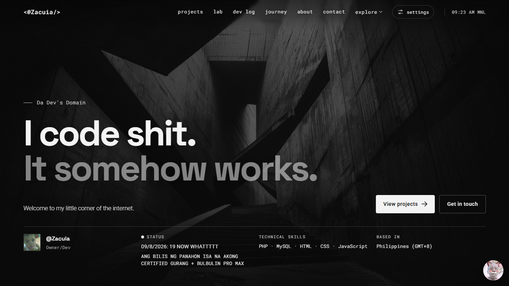
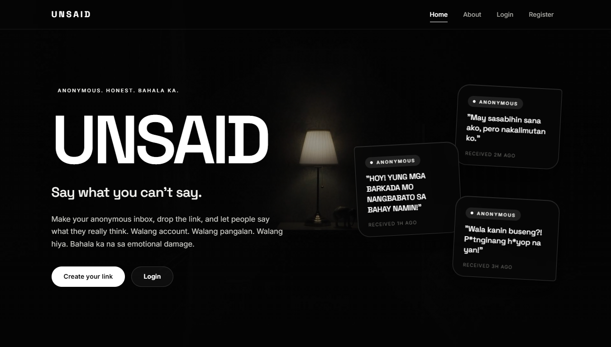
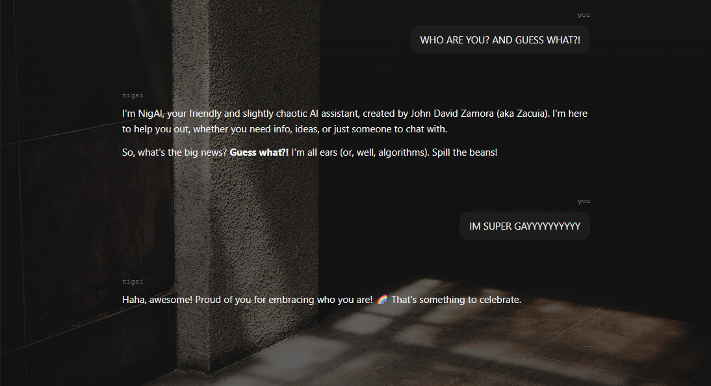
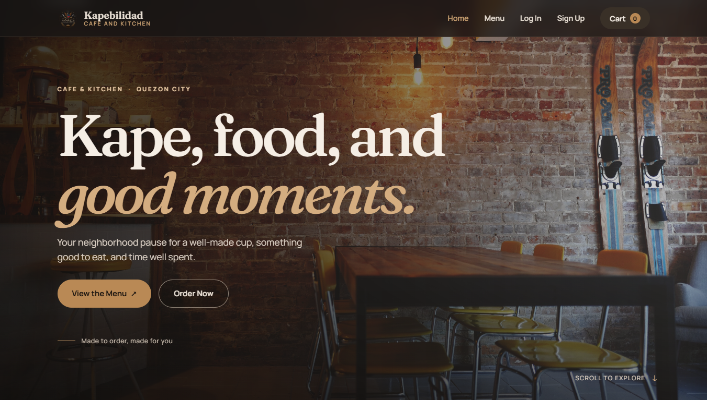
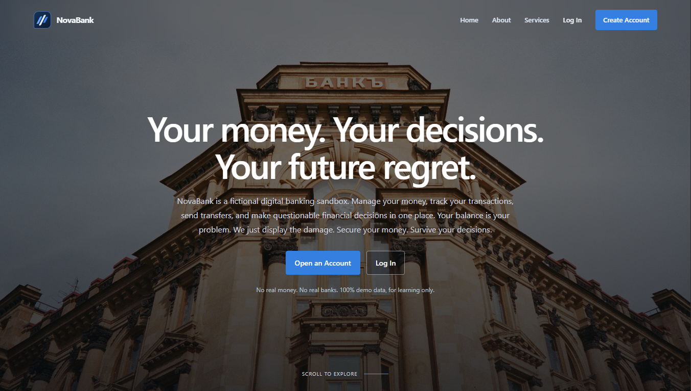
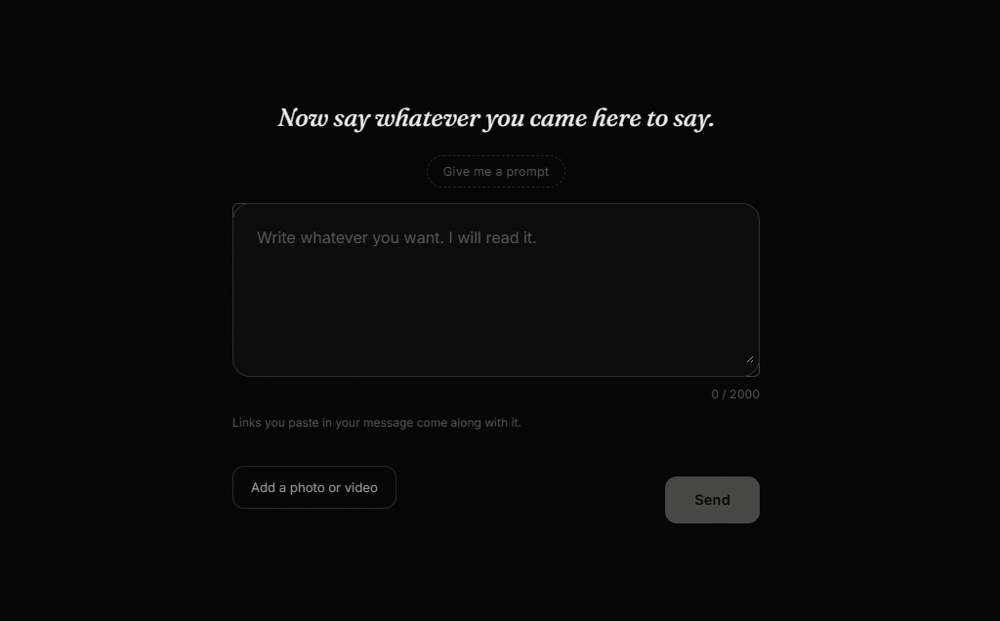
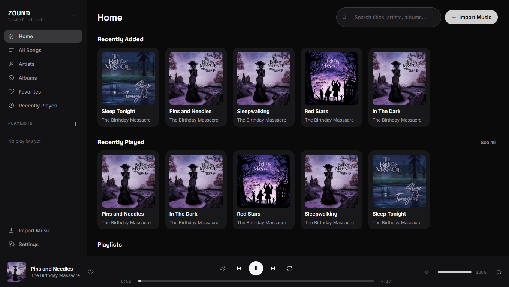
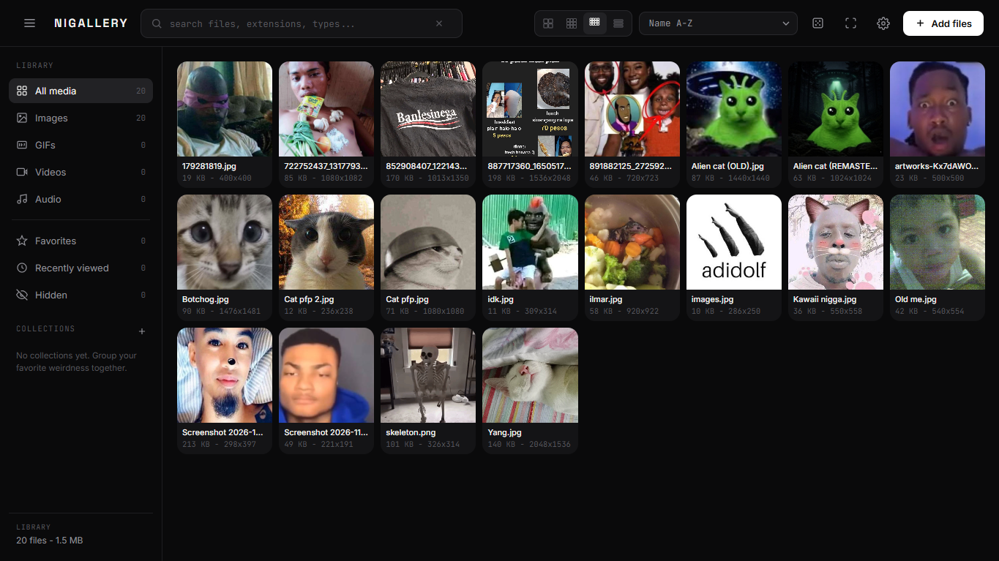

# PHP & Laravel Web Developer

### Junior Web Developer · 19 Year Old BSIT Student

I build practical web applications using **PHP, Laravel, MySQL, JavaScript, and Tailwind CSS**.

From database driven systems and custom admin panels to APIs, authentication systems, and full stack web applications, I enjoy turning ideas into functional software.

Currently growing as a Laravel developer, improving my backend architecture, and exploring modern frontend development.

Still learning. Still building. Still breaking shit.

---

## About Me

```text
Age          19 Years Old
Role         Junior Web Developer
Education    2nd Year BSIT Student
Location     Philippines
Specialty    PHP / Backend Web Development
Framework    Laravel
Frontend     HTML / CSS / JavaScript / Tailwind CSS
Database     MySQL
Tools        Git / GitHub / Composer / Herd
Exploring    React
```

I'm a self taught Junior Web Developer and BSIT student from the Philippines.

My primary focus is **PHP and Laravel development**, with an interest in building reliable, maintainable, and practical web applications.

I've built and maintained **10+ personal and academic projects**, including full stack applications, database driven systems, custom CMS platforms, and API integrations.

I enjoy understanding how things work behind the scenes, especially backend logic, database architecture, application structure, and server side development.

I believe the best way to learn development is to actually build things.

---

## What I Build

```text
Full Stack Web Applications
Backend Systems
Database Driven Applications
CRUD Applications
REST API Integrations
Authentication & User Management
Admin Panels & Dashboards
Custom CMS Systems
File & Image Management
Search & Filtering Systems
Analytics & Reporting
Responsive Web Interfaces
```

---

## Featured Projects

### DaDevDomain

**My personal developer platform and portfolio.**

MY MAIN PROJECT/BUILD. A fucking ultimate full stack web platform with a custom CMS, project management, GitHub API integration, visitor analytics, contact inbox, file management, search and filtering, and responsive UI.



**PHP · MySQL · JavaScript · HTML · CSS**

[Live Website](https://zacuia.gt.tc)

---

### Unsaid

**Anonymous Messaging Web Application**

An anonymous PHP messaging system where people say shit they would never say out loud.



**PHP · MySQL · JavaScript · HTML · CSS**

[Live Website](https://unsaid.gt.tc)

---

### NigAI

**AI Powered Chatbot**

A fucking AI ch atbot built with PHP, JavaScript, and an external AI API.



**PHP · JavaScript · HTML · CSS · AI APIs**

[Live Website](https://nigai.ct.ws/)

---

### Kapebilidad

**Cafe Ordering System**

A fucking PHP cafe ordering system where one coffee somehow became an entire web application.



**PHP · MySQL · JavaScript · HTML · CSS**

[Live Website](https://kapebilidad.ct.ws)

---

### Novabank

**Banking System Concept**

I made a fake bank in PHP because FUCK YOU that's why.



**PHP · MySQL · JavaScript · HTML · CSS**

[Live Website](https://creations.mtdv.me/novabank)

---

### AMW

I made this because fuck youuuuu hahahah and why not?



**PHP · MySQL · JavaScript · HTML · CSS**

[Live Website](https://notzacuia.likesyou.org)

---

### Zound

**Local Music Player**

A fucking local music player for your own music, without ads or subscriptions.



**HTML · CSS · JavaScript**

[Live Website](https://lilbuffy.github.io/Zound/)

---

### Nigallery

**Personal Gallery Application**

I got tired of looking at a fucking folder, so I made a whole gallery for it.



**HTML · CSS · JavaScript**

[Live Website](https://lilbuffy.github.io/Nigallery/)

---

## Tech Stack

### Languages


### Backend & Frameworks


### Frontend


### Database


### Development Tools


---

## Currently Learning & Exploring

```text
Laravel Development
Tailwind CSS
PHP Architecture & Best Practices
Database Design & Optimization
Web Application Security
REST API Development
Git & GitHub Workflows
```

### What's Next?

```text
React.js
Modern Frontend Development
Advanced Laravel Concepts
```

My goal is to become a well rounded full stack developer with strong backend foundations and the ability to build modern, scalable web applications.

---

## Experience

### Freelance Web Developer

Built and delivered websites for personal contacts based on their requirements.

Responsibilities included:

```text
Project Planning
UI Design
Feature Development
Frontend Development
Backend Development
Database Integration
Testing & Debugging
Deployment
```

### Independent Web Developer

Built and maintained **10+ personal and academic web projects**, gaining practical experience in PHP development, database management, application logic, API integration, and web deployment.

---

## GitHub Stats


---

## Find Me

**Portfolio**

[https://zacuia.gt.tc](https://zacuia.gt.tc)

**ВКонтакте**

[https://vk.ru/zacuia](https://vk.ru/zacuia)

---

```text
learn → build → break → debug → improve → repeat
```

### Learning shit, breaking shit, and getting better at web development. If you are reading this... I'm so proud of you.
